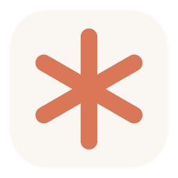

<div align="center">



# Spark

**Press a shortcut. Type. Done.**

A tiny command bar for your desktop that opens apps, searches the web, does math, takes notes, sets timers and asks your own AI, without touching the mouse.

Windows 10 / 11 · macOS · Linux · light enough for old laptops

[](https://github.com/Denizprof/spark/releases/latest)

[](https://github.com/Denizprof/spark/releases/latest)


[Commands](#commands) · [Make it yours](#make-it-yours) · [Plugins](#plugins) · [Report a problem](https://github.com/Denizprof/spark/issues/new/choose)

</div>

---

## Why Spark

- **Instant:** <kbd>Ctrl</kbd>+<kbd>Shift</kbd>+<kbd>Space</kbd> opens the bar from anywhere, and <kbd>Esc</kbd> closes it.
- **Easy:** suggestions appear as you type. <kbd>Tab</kbd> completes a command, <kbd>↑</kbd>/<kbd>↓</kbd> pick one, and math answers itself (`12*7` shows `= 84` live).
- **Light:** built with Tauri, which uses the web engine your OS already has. There's no bundled browser: the Windows program is about 5 MB and uses around 30 MB of memory, so it runs fine on old or cheap laptops.
- **115+ commands** built in, and you can add your own with a few lines of JavaScript.
- **Private:** your notes, to-dos and settings stay on your computer. The AI runs locally through [Ollama](https://ollama.com).
- **Easy on the eyes:** a soft floating bar with automatic light and dark mode. Drag it anywhere with the middle mouse button.
- **Yours to customize:** change the shortcut, add your own quick links, and write your own commands. See [Make it yours](#make-it-yours).

## Download

Get the latest version from [**Releases**](https://github.com/Denizprof/spark/releases/latest):

| Your computer | File |
| --- | --- |
| Windows 10 / 11 | `Spark_x.y.z_x64-setup.exe` |
| Mac with Apple Silicon (M1–M4) | `Spark_x.y.z_aarch64.dmg` |
| Mac with Intel | `Spark_x.y.z_x64.dmg` |
| Linux (any distro) | `Spark_x.y.z_amd64.AppImage` |
| Ubuntu / Debian · Fedora | `.deb` · `.rpm` |

The first time Spark runs, a settings window opens. Pick your shortcut, add quick links, then press **Save & Start**. Spark lives in your system tray. To change settings, open Spark again or type `settings`.

<details>
<summary>First-run notes per system</summary>

- **Windows:** SmartScreen may warn about a new app. Click *More info → Run anyway*. Spark needs the Microsoft Edge WebView2 runtime, which Windows 10/11 already has; the installer adds it if it's missing.
- **macOS:** if macOS says the app can't be opened, right-click it and choose **Open**. Allow Spark under *System Settings → Privacy & Security → Accessibility* so the shortcut works everywhere.
- **Linux:** make the AppImage executable (`chmod +x Spark*.AppImage`). The `apps` command uses `wmctrl` if it's installed. On Wayland, some desktops limit global shortcuts.

</details>

## Commands

Type `help` to see them all, or `help <word>` to search. Anything that isn't a command gets opened, so `github`, `notepad`, `~/Documents` and `example.com` all just work.

| | Commands |
| --- | --- |
| **Basics** | `open` · `calc` / `=` · `help` · `settings` · `reload` · `quit` |
| **Notes & to-dos** | `note` · `notes [word]` · `todo` · `todos` · `done <n>` |
| **Time & dates** | `timer` · `remind` · `pomodoro` · `stopwatch` · `time` · `tz <city>` · `cal` · `week` · `until <date>` · `age <date>` · `ts` · `moon` |
| **Search** (type it alone to open the site) | `g` / `google` · `yt` · `wiki` · `maps` · `tr` · `define` · `img` · `news` · `shop` · `bing` · `ddg` · `reddit` · `x` · `amazon` · `ebay` · `imdb` · `spotify` · `steam` · `pinterest` · `lyrics` · `recipe` · `flights` · `scholar` · `chat` · `perplexity` · `gh` · `so` · `npm` · `pypi` · `mdn` |
| **Know things** | `ask` / `ai` (local AI) · `whatis <topic>` · `meaning <word>` · `weather` · `fx` (currency) · `joke` · `fact` · `quote` |
| **Clipboard** | `copy` · `paste` · `clips` (history) · `clip <n>` · `sortlines` · `dedupe` · `qr` |
| **Generators** | `pass` · `pin` · `uuid` · `rand` · `pick` · `coin` · `dice` · `lorem` · `emoji` |
| **Text** | `upper` · `lower` · `title` · `reverse` · `slug` · `count` · `json` · `morse` · `nato` · `regex` · `b64` · `unb64` · `hash` · `urlenc` · `urldec` |
| **Numbers** | `conv` (km, kg, °C, GB…) · `pct` · `tip` · `sum` · `avg` · `hex` · `roman` · `bmi` · `compound` · `color` |
| **Your computer** | `downloads` · `desktop` · `documents` · `pictures` · `music` · `videos` · `data` · `apps` · `sysinfo` · `ip` · `myip` · `ping` · `lock` |

**Quick links** come ready to use: `mail`, `calendar`, `drive`, `gdocs`, `sheets`, `photos`, `outlook`, `whatsapp`, `discord`, `telegram`, `instagram`, `linkedin`, `netflix`, `twitch`, `notion`, `figma`, `github`, `chatgpt`, `claude`, `speedtest`. You can add your own or remove these in Settings.

A few to try:

```
= 2^10                  → 1024
whatis black hole       → a short Wikipedia summary
fx 100 usd eur          → today's exchange rate
conv 5 km mi            → 3.106856 mi
pomodoro                → rings in 25 minutes
pick pizza, sushi, tacos
ask how do I center a div
```

## AI answers (optional)

`ask` sends your question to [Ollama](https://ollama.com) running on your own machine, so nothing leaves your computer. Install Ollama, run `ollama pull llama3.1`, and you're set. You can change the server and model under **Settings → Ollama settings**.

## Make it yours

Spark is built to be customized. You don't need to know how to code for the first three:

| What | How |
| --- | --- |
| **Shortcut** | Settings → Shortcut. Click it and press any key combination. |
| **Quick links** | Settings → Quick links → *Add link*. Give it a name (`bank`, `school`, `work`) and a website, app or folder. Then type the name in the bar to open it. |
| **Start at login, Ollama server and model** | Settings. Type `settings` in the bar to open it. |
| **Your own commands** | Write a small plugin, below. Your commands show up in suggestions and `help` like built-in ones, and you can even replace a built-in command with your own version. |

## Plugins

Drop a `.js` file into Spark's plugins folder (type `data` to open it) and type `reload`:

```js
// plugins/shout.js
export default function (spark) {
  spark.command('shout', { help: 'shout <text> - make it loud', aliases: ['s'] }, (text) => {
    return text.toUpperCase() + '!';
  });
}
```

A command gets the text after its name and returns what to show. It can also be `async`. `spark` gives you `post(text)`, `alert(text)`, `after(ms, fn)`, `http(method, url, body)`, `clipboard` and `config`. If a plugin breaks, Spark tells you which file and keeps running.

## Where your data lives

Settings, notes (`notes.md`), to-dos (`todo.txt`) and plugins are kept in your user app-data folder. To carry Spark on a USB stick, make a folder called `spark_data` next to the Spark program and it will use that folder instead.

## Build from source

> **Just want to use Spark?** You don't need any of this. Download it from [Releases](https://github.com/Denizprof/spark/releases/latest). The tools below are only for building it yourself.

| You need | Version | Check with |
| --- | --- | --- |
| [Node.js](https://nodejs.org) | **20 or newer** (older versions can't run the tests) | `node -v` |
| [Rust](https://rustup.rs) | latest stable | `rustc -V` |
| [Tauri prerequisites](https://tauri.app/start/prerequisites/) | for your system (WebView2 on Windows, Xcode tools on macOS, WebKitGTK on Linux) | |

```bash
npm install
npm test          # engine tests
npm run dev       # run Spark in development
npm run build     # build the installer for this computer
```

Pushing a tag like `v1.0.0` makes GitHub Actions build Spark for Windows, macOS and Linux and attach the files to a draft release.

## Roadmap

- Fuzzy search through files and apps
- Calendar and email commands
- Themes and custom accent colors
- Plugin gallery

## License

Spark is **source-available, not open source**. You can download and use it for free, and read the code. You may not copy, redistribute, re-publish or sell it, or use it to promote something else. See [LICENSE](LICENSE) for the full terms.
